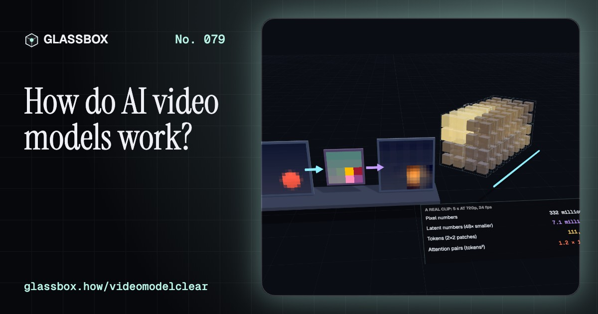
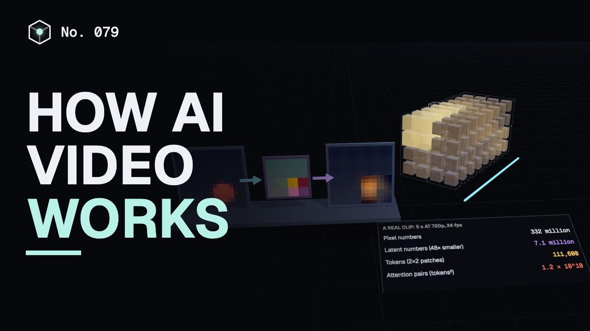
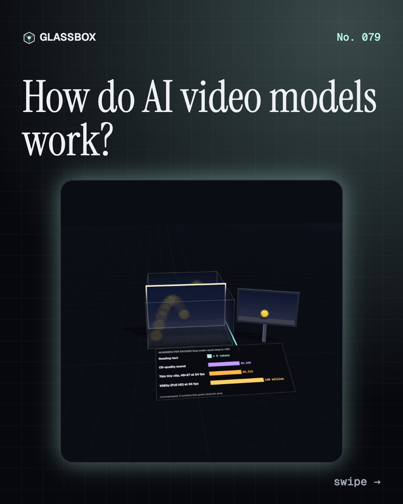
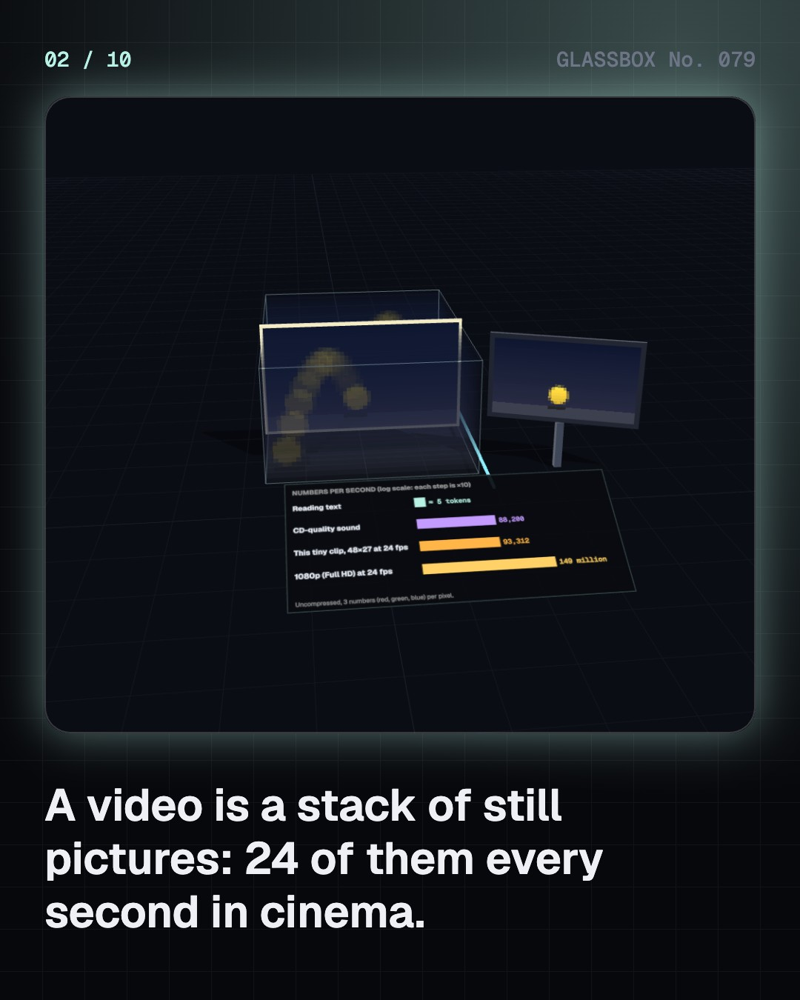
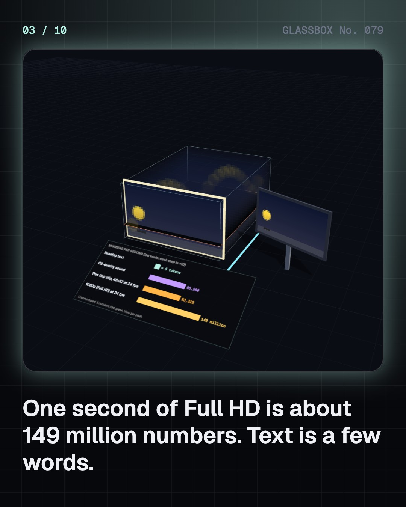
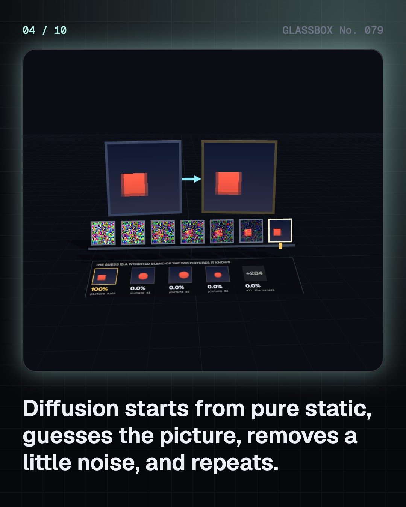

<!-- glassbox:start -->
<!-- Generated from glassbox.json by the Glassbox hub (npm run readme -- videomodelclear). Edit glassbox.json, not this block. -->
<p align="center"><a href="https://glassbox-production-fd52.up.railway.app/e/videomodelclear/"></a></p>

<h1 align="center">VideoModelClear</h1>

<p align="center"><b>How do AI video models work?</b><br>Every AI video starts as pure static. Watch a real diffusion model pull a picture out of noise in your browser, steer it with a prompt, see why frames flicker when they are made one at a time, and test whether a hidden watermark survives an edit.</p>

<p align="center"><a href="https://glassbox-production-fd52.up.railway.app/videomodelclear/"><b>▶ Play with it</b></a> &nbsp;·&nbsp; <a href="https://glassbox-production-fd52.up.railway.app/e/videomodelclear/">Read the 60-second explainer</a> &nbsp;·&nbsp; <a href="https://glassbox-production-fd52.up.railway.app/videomodelclear/glassbox/reel.mp4">Watch the 40-second video</a></p>

<p align="center">
  <a href="https://glassbox-production-fd52.up.railway.app/e/videomodelclear/"></a>
  <a href="https://glassbox-production-fd52.up.railway.app/e/videomodelclear/"></a>
  <a href="LICENSE"></a>
  <a href="LICENSE-CONTENT.md"></a>
  <a href="#privacy"></a>
</p>

## In 60 seconds

1. **A video is a huge stack of numbers.** Frames stacked over time make a space-time cube. One second of Full HD at 24 fps is about 149 million numbers, millions of times more than the text you read in that second. A video model has to decide all of them.
2. **Diffusion: noise in, picture out.** Models learn to guess the clean picture hidden under noise. To create, they start from pure static, guess, remove a little noise and repeat, 20 to 50 times. Our toy does it for real with an exact denoiser, which is why it can only copy its 288 pictures; real networks approximate and so can blend.
3. **Squeeze, then cut into patches.** An autoencoder squeezes video into a small latent cube, about 48 times smaller in open models. The cube is cut into space-time patches that act as tokens, and a transformer lets every patch attend to every other one. Attention cost grows with tokens squared.
4. **Words steer every step.** A text encoder turns the prompt into numbers the denoiser reads. Classifier-free guidance mixes a guess made with the prompt and one without: guess = without + w × (with − without). At w = 0 the prompt is ignored; higher obeys more but loses variety.
5. **Consistency is the hard part.** Make each frame alone and the object teleports and changes colour. Denoise the whole clip as one block and motion comes out smooth. Real models still slip on physics, hands and objects that appear from nowhere, because they learn patterns, not rules.
6. **Costly, and easy to mistake for real.** A 5-second clip took about 3.4 million joules in 2025 tests of open models, far more than a picture or a text reply. Deepfakes without consent cause real harm. Watermarks and content credentials help but can be weakened or stripped, and India's 2026 IT Rules require labels.

## Words worth knowing

| Term | Meaning |
|---|---|
| **Frame** | One still picture in a video; cinema shows 24 every second. |
| **Diffusion model** | A generator that starts from random noise and removes it step by step to reveal a picture or video. |
| **Denoiser** | The trained network that guesses the clean picture from a noisy one. |
| **Latent** | A compressed version of the video, made by an autoencoder, that the model actually works on. |
| **Space-time patch** | A small block of the latent cube, a few cells wide and a few frames long, used as one token. |
| **Attention** | Each token scores every other token and takes a weighted mix of their information. |
| **Classifier-free guidance** | Pushing each step further towards the prompt by mixing guesses made with and without it. |
| **Temporal consistency** | Objects staying the same from frame to frame unless they should change. |
| **Content credentials** | A signed record attached to a file saying how it was made and edited (the C2PA standard). |

## A short history

**From a row of cameras photographing a galloping horse in 1878 to models that turn a sentence into a talking film clip, and the rules that followed.**

- **1878** · A galloping horse, frame by frame (Eadweard Muybridge, Palo Alto, California, United States)
- **2014** · Two networks play a game (Ian Goodfellow and colleagues, Université de Montréal, Canada)
- **2016** · The first tiny AI videos (Carl Vondrick, Hamed Pirsiavash and Antonio Torralba, MIT, Cambridge, United States)
- **2020** · Diffusion finally works (Jonathan Ho, Ajay Jain and Pieter Abbeel, UC Berkeley, United States)
- **2022** · Stable Diffusion is released openly (Stability AI, CompVis at LMU Munich and Runway, Munich, Germany and London, United Kingdom)
- **2023** · India warns platforms about deepfakes (Ministry of Electronics and Information Technology (MeitY), New Delhi, India)
- **2024** · Sora: up to a minute of video (OpenAI, San Francisco, United States)
- **2025** · Pictures and sound in one go (Google DeepMind, Mountain View, United States)

The full story, with 30 moments, charts, people and 50 sources: [glassbox.how/e/videomodelclear/history](https://glassbox-production-fd52.up.railway.app/e/videomodelclear/history/). The data lives in [`history.json`](history.json).

## Video and slides

Made with the Glassbox studio from this box's storyboard (`window.glassbox.director`). Free to reuse under CC BY 4.0.

<a href="https://glassbox-production-fd52.up.railway.app/videomodelclear/glassbox/video.mp4"></a>

<p><a href="glassbox/slide-1.jpg"></a> <a href="glassbox/slide-2.jpg"></a> <a href="glassbox/slide-3.jpg"></a> <a href="glassbox/slide-4.jpg"></a></p>

| File | What | Size |
|---|---|---|
| [`glassbox/reel.mp4`](https://glassbox-production-fd52.up.railway.app/videomodelclear/glassbox/reel.mp4) | Reel / Short, with captions and soundtrack | 1080×1920 |
| [`glassbox/video.mp4`](https://glassbox-production-fd52.up.railway.app/videomodelclear/glassbox/video.mp4) | YouTube video, with captions and soundtrack | 1920×1080 |
| `glassbox/slide-1…10.jpg` | Instagram carousel | 1080×1350 |
| `glassbox/thumb.jpg` | YouTube thumbnail | 1280×720 |
| `glassbox/cover.jpg` | Share card and repo social preview | 1200×630 |
| [`glassbox/history-reel.mp4`](https://glassbox-production-fd52.up.railway.app/videomodelclear/glassbox/history-reel.mp4) | “History in 10 moments” Reel / Short | 1080×1920 |
| `glassbox/history-slide-*.jpg` | History carousel | 1080×1350 |
| `glassbox/post.json` | Post copy and schedule used by the publish kit | |

## Privacy

This box has no accounts and no ads, and it ships its own fonts and libraries. When you run it yourself it sends nothing anywhere. On glassbox.how, the site's `/bar.js` also loads Glassbox's analytics: **Google Analytics** to count visits (it asks first in the EU, UK and Switzerland, and stays off when your browser sends Global Privacy Control or Do Not Track) and **ClickTrust** to detect bots.

It remembers a few things **in your own browser only**, and never sends them anywhere:

| Browser storage key | What it holds |
|---|---|
| `videomodelclear.v1` | Which chapters you have opened, your best quiz scores, and sound on or off. |

Exactly what each one sees is at [glassbox.how/privacy](https://glassbox-production-fd52.up.railway.app/privacy/).

## Licences

- **Code:** [MIT](LICENSE). Use it, change it, ship it.
- **Explanations, text, images and videos** (`glassbox.json`, `glassbox/`): [CC BY 4.0](LICENSE-CONTENT.md). Credit “Glassbox, glassbox.how/e/videomodelclear”.
- **Third-party parts** keep their own licences: [three.js](https://threejs.org) (MIT), [Geist, Instrument Serif](https://openfontlicense.org) (SIL OFL 1.1).
- The Glassbox name and logo aren't covered by either licence. See the [terms](https://glassbox-production-fd52.up.railway.app/terms/).

Found a mistake? [Open an issue](https://github.com/bdeeps/videomodelclear/issues). Corrections happen in public.
<!-- glassbox:end -->

## Run it

It's plain HTML, CSS and JavaScript. No build step and no dependencies. Run locally, it contacts no other website.

```bash
python3 -m http.server 8000
```

Three.js and the fonts ship in `vendor/` and `fonts/`, so it also works offline.

Then open http://localhost:8000.

## How it's built

| File | What |
|---|---|
| `index.html`, `css/app.css` | The page and its styles |
| `js/app.js`, `js/stage.js`, `js/ui.js`, `js/kit.js` | The shared Glassbox 3D engine: chapters, 3D stage, controls, quiz, video director |
| `js/chapters/*.js` | One file per chapter: the 3D model, controls, text, key terms, quiz and video scenes |
| `js/vid.js` | The tiny real models: procedural shape pictures and clips, the exact (ideal) denoiser, a DDIM sampler with classifier-free guidance, a PCA autoencoder, and drawing helpers |
| `glassbox.json` | Title, question, explainer beats, key terms, browser storage and credits shown on glassbox.how |
| `reel` in each chapter | The storyboard the Glassbox studio records into short videos |
| `glassbox/` | The published video, slides, thumbnail and post copy |
| `fonts/`, `vendor/three/` | Self-hosted Geist and Instrument Serif (SIL OFL 1.1) and three.js (MIT) |
